# 🍷 Informe Técnico — Arquitectura de Microservicios y Monitoreo con Prometheus & Grafana en Kubernetes

**Proyecto:** Bodega Peirano — Sistema Distribuido de Catálogo y Pedidos  
**Autor:** Mario Ry / Equipo de Desarrollo Bodega Peirano  
**Entorno:** Kubernetes (Minikube) con Prometheus Operator & Grafana  

---

## 📌 Parte A — Fundamentos Conceptuales

### 1. ¿Qué es Micrometer y por qué se usa en lugar de la librería directa de Prometheus?

**Micrometer** es una fachada de instrumentación dimensional de métricas para aplicaciones en la Máquina Virtual de Java (JVM), comúnmente llamada el *"SLF4J de las métricas"*. Proporciona una interfaz neutral e independiente del proveedor (vendor-neutral) sobre la cual se registran medidores (meters) como `Counter`, `Gauge`, `Timer` y `DistributionSummary`.

#### ¿Por qué usar Micrometer en lugar del cliente directo de Prometheus (`client_java`)?
1. **Desacoplamiento Tecnológico (Vendor-Neutral):** Si la organización decide migrar su infraestructura de observabilidad o enviar métricas en paralelo a otros destinos (por ejemplo, Datadog, Dynatrace, New Relic, AWS CloudWatch o InfluxDB), el código fuente de los microservicios no sufre ninguna modificación. Solo se añade el registry correspondiente en el archivo `pom.xml` (`micrometer-registry-datadog`, etc.).
2. **Integración Profunda con Spring Boot Actuator:** Spring Boot 3 utiliza Micrometer como su motor nativo de métricas. Esto permite que, sin escribir código adicional, se instrumenten automáticamente los hilos de Tomcat, los consumos de memoria Heap/Non-Heap, Garbage Collection, pools de conexiones y todas las llamadas HTTP de entrada y salida (`WebClient`).
3. **Estandarización de Nomenclatura y Tags:** Micrometer permite nombrar las métricas en formato estándar con puntos (ej. `bodega.catalogo.consulta.duracion`) y, al exponerlas en `/actuator/prometheus`, las traduce automáticamente a la convención de Prometheus (`snake_case` con sufijos de unidad `bodega_catalogo_consulta_duracion_seconds`).

---

### 2. ¿Cuál es la diferencia entre Counter, Gauge y Timer? Da un ejemplo de cada uno tomado de tu código.

| Tipo de Métrica | Comportamiento | Uso Típico | Ejemplo en Código de Bodega Peirano |
| :--- | :--- | :--- | :--- |
| **Counter (Contador)** | Valor monotónicamente creciente; **solo puede aumentar** o reiniciarse a cero al reiniciar el proceso. | Contar eventos discretos acumulados (peticiones, ventas, errores). | `bodega_catalogo_stock_descontado_total` en `CatalogoMetrics.java` (Líneas 37-39). |
| **Gauge (Medidor Instantáneo)** | Valor escalar instantáneo que **puede subir o bajar** libremente en cualquier momento. | Registrar el estado actual de un recurso (nivel de inventario, conexiones, delay). | `bodega_catalogo_stock_total` en `CatalogoMetrics.java` (Líneas 56-59) y `bodega_pedidos_tasa_rechazo`. |
| **Timer (Temporizador)** | Mide simultáneamente **latencia (duración)** y **frecuencia (conteo)** de operaciones cortas. | Tiempos de respuesta de endpoints, llamadas HTTP entre microservicios. | `bodega_catalogo_consulta_duracion_seconds` en `CatalogoMetrics.java` (Líneas 42-45). |

#### Ejemplos tomados directamente del código de Bodega Peirano:

* **Counter:**
  ```java
  // catalogo-service/src/main/java/com/bodegapeirano/catalogo/metrics/CatalogoMetrics.java
  this.stockDescontadoTotalCounter = Counter.builder("bodega_catalogo_stock_descontado_total")
          .description("Total de unidades de vino descontadas del inventario por ventas")
          .register(registry);
  ```

* **Gauge:**
  ```java
  // catalogo-service/src/main/java/com/bodegapeirano/catalogo/metrics/CatalogoMetrics.java
  public void registrarGaugeStockTotal(Supplier<Number> stockTotalSupplier) {
      Gauge.builder("bodega_catalogo_stock_total", stockTotalSupplier)
              .description("Cantidad total de botellas en inventario en Bodega Peirano")
              .register(registry);
  }
  ```

* **Timer:**
  ```java
  // catalogo-service/src/main/java/com/bodegapeirano/catalogo/metrics/CatalogoMetrics.java
  this.consultaTimer = Timer.builder("bodega_catalogo_consulta_duracion_seconds")
          .description("Tiempo empleado en procesar consultas al catalogo")
          .publishPercentileHistogram()
          .register(registry);
  ```

---

### 3. ¿Qué es un ServiceMonitor y cómo sabe el Prometheus Operator qué monitorear?

Un **ServiceMonitor** es una Definición de Recurso Personalizado (CRD) provista por el **Prometheus Operator** (`monitoring.coreos.com/v1`). Sirve para describir de manera declarativa qué servicios de Kubernetes deben ser descubiertos y recolectados (*scraped*) por Prometheus.

#### ¿Cómo sabe el Prometheus Operator qué monitorear?
1. **Descubrimiento por Etiquetas (CRD Prometheus):** El Prometheus Operator vigila el cluster y busca recursos `ServiceMonitor` cuyo conjunto de etiquetas coincida con la configuración `serviceMonitorSelector` declarada en la especificación del recurso `Prometheus`.
2. **Selección del Service de Kubernetes (`spec.selector`):** Dentro del `ServiceMonitor`, el bloque `spec.selector.matchLabels` define las etiquetas que debe tener el `Service` de Kubernetes a monitorear (en nuestro caso, `app: catalogo-service` y `app: pedidos-service`).
3. **Identificación de Endpoints y Puertos (`spec.endpoints`):** El `ServiceMonitor` especifica el nombre del puerto del `Service` (debe llamarse exactamente `port: http`), la ruta HTTP donde se exponen las métricas (`path: /actuator/prometheus`) y el intervalo de recolección (`interval: 10s`).
4. **Generación Dinámica de Configuración:** Con estos datos, el Operator genera dinámicamente y sin recargas manuales los bloques `scrape_configs` en el servidor de Prometheus.

---

### 4. ¿Cuál es la diferencia entre liveness probe y readiness probe?

Ambas son sondas de diagnóstico ejecutadas periódicamente por el Kubelet, pero sus propósitos y consecuencias de fallo son completamente distintos:

| Criterio | Liveness Probe (Sonda de Vida) | Readiness Probe (Sonda de Disponibilidad) |
| :--- | :--- | :--- |
| **Pregunta que responde** | *¿El contenedor está vivo y saludable internamente?* | *¿El contenedor está listo para recibir peticiones de clientes?* |
| **Acción si falla** | **Reinicia el contenedor:** Kubelet mata el proceso del contenedor e inicia uno nuevo según la `restartPolicy`. | **Aísla el pod del tráfico:** Kubernetes retira la IP del pod de los endpoints del `Service`. No se mata el contenedor. |
| **Casos de uso típicos** | Deadlocks irrecuperables, bucles infinitos, OutOfMemory. | Carga inicial de datos en memoria, calentamiento de conexiones a BD o llamadas externas. |
| **Endpoint en Bodega Peirano** | `/actuator/health/liveness` | `/actuator/health/readiness` |

---

### 5. ¿Por qué es necesario apuntar Docker al daemon de Minikube antes de construir las imágenes?

Minikube se ejecuta como un entorno virtualizado o dentro de un contenedor dedicado (driver Docker) que posee su **propio daemon de Docker y su propio almacenamiento de imágenes interno**.

* Si ejecutamos `docker build` en nuestra máquina física sin configurar el entorno, la imagen resultante se guarda en el daemon de la máquina anfitriona (Host OS).
* Cuando Kubernetes intenta desplegar un pod configurado con `imagePullPolicy: IfNotPresent` o `Never`, busca la imagen dentro del daemon interno de Minikube. Al no encontrarla allí, intentará buscarla en Docker Hub público, resultando en el error `ErrImagePull` o `ImagePullBackOff`.
* Al ejecutar:
  * En PowerShell: `& minikube -p minikube docker-env --shell powershell | Invoke-Expression`
  * En Bash: `eval $(minikube docker-env)`
  Se redirigen las variables de entorno de la consola (`DOCKER_HOST`, `DOCKER_TLS_VERIFY`, `DOCKER_CERT_PATH`) para que el comando `docker build` construya y registre las imágenes directamente en el almacén interno de Minikube, permitiendo que los pods inicien inmediatamente.

---

### 6. ¿Qué ocurre si no configuras el selector de ServiceMonitors en el values.yaml del chart?

Por defecto, la instalación oficial del chart `kube-prometheus-stack` incluye la regla restrictiva:
```yaml
serviceMonitorSelectorNilUsesHelmValues: true
```
Bajo esta configuración por defecto, el Prometheus Operator **solo recolecta ServiceMonitors que estén ubicados en el mismo namespace de monitoreo (`monitoring`) y que tengan la etiqueta `release: prometheus`**.

**Consecuencia directa:** Si un desarrollador despliega sus microservicios y sus `ServiceMonitors` en el namespace del proyecto (`bodega-peirano`), Prometheus **los ignorará por completo**. Como resultado, los endpoints nunca aparecerán en `/targets` de Prometheus y Grafana no recibirá ninguna métrica de los microservicios.

**Solución aplicada en `k8s/values-prometheus.yaml`:**
```yaml
prometheus:
  prometheusSpec:
    serviceMonitorSelectorNilUsesHelmValues: false
    serviceMonitorNamespaceSelector: {}
    serviceMonitorSelector: {}
```
Esto le indica a Prometheus que busque y acepte ServiceMonitors en **cualquier namespace del cluster**.

---

## 📊 Parte B — Consultas PromQL del Sistema

### 1. Tasa de requests por minuto de tu Servicio B en los últimos 5 minutos
```promql
sum(rate(bodega_pedidos_creados_total[5m])) * 60
```
* **Explicación:** Calcula la derivada por segundo de los pedidos creados en los últimos 5 minutos (`rate`) y la multiplica por 60 para convertirla a peticiones por minuto. (También se puede formular con la métrica estándar: `sum(rate(http_server_requests_seconds_count{application="pedidos-service"}[5m])) * 60`).

---

### 2. Latencia p95 del endpoint más crítico de tu sistema
El endpoint más crítico de Bodega Peirano es `POST /api/pedidos` (procesamiento y validación contra catálogo):
```promql
histogram_quantile(0.95, sum(rate(bodega_pedidos_procesamiento_duracion_seconds_bucket[5m])) by (le))
```
* **Explicación:** Aplica la función `histogram_quantile` sobre los buckets de distribución acumulada del Timer de Micrometer (`publishPercentileHistogram()`) para obtener el percentil 95 de duración en segundos.

---

### 3. Estado UP/DOWN de ambos servicios al mismo tiempo
```promql
up{namespace="bodega-peirano", endpoint="http"}
```
* **Explicación:** Devuelve el vector instantáneo del estado de salud de los endpoints scrapeados por los ServiceMonitors en el namespace `bodega-peirano`. Retorna `1` si el microservicio responde correctamente o `0` si está caído.

---

### 4. Consulta que responde una pregunta de negocio propia del dominio
**Pregunta de Negocio:** *¿Cuál es el porcentaje actual de pedidos rechazados respecto al total en la bodega vitivinícola?*
```promql
(sum(rate(bodega_pedidos_creados_total{estado="rechazado"}[2m])) / (sum(rate(bodega_pedidos_creados_total[2m])) > 0)) * 100
```
* **Explicación:** Divide la tasa de pedidos con tag `estado="rechazado"` entre la tasa total de pedidos recibidos en los últimos 2 minutos, multiplicando por 100. Permite alertar si la tasa supera el umbral crítico del 30%.

---

## 🧪 Parte C — Evidencias de Casuísticas

---

### 🔴 Casuística 1 — El Servicio Caído (CrashLoopBackOff por Error de Configuración)

* **Contexto Narrativo:** Durante una actualización de configuración en el entorno productivo de Bodega Peirano, un operador asigna erróneamente un parámetro JVM de inicio no válido (`JAVA_TOOL_OPTIONS="-XX:InvalidJvmFlag"`) en las variables de entorno del microservicio de Catálogo (`catalogo-service`). Al intentar iniciar, la Máquina Virtual de Java (JVM) detecta una opción no reconocida, aborta el arranque inmediatamente (`Error: Could not create the Java Virtual Machine`) y el contenedor finaliza con código de salida 1 repetidamente.
* **Síntoma:** El Servicio A se vuelve inaccesible. Los clientes que intentan comprar pedidos reciben errores HTTP 503 ("Servicio de catálogo no disponible") porque el Servicio B no puede validar stock.
* **Comando de Activación:**
  ```bash
  kubectl set env deployment/catalogo-deployment -n bodega-peirano JAVA_TOOL_OPTIONS="-XX:InvalidJvmFlag"
  ```


---

> #### 📸 [EVIDENCIA 1A: CAPTURA DE PANTALLA REQUERIDA]

> ```
> +-----------------------------------------------------------------------------------+
> | [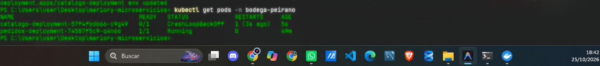 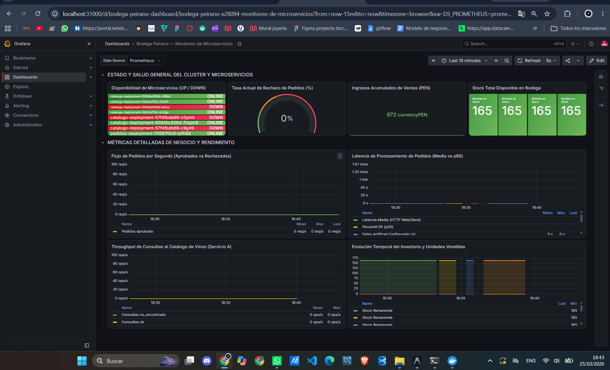]   |
> +-----------------------------------------------------------------------------------+
> ```
>  Se evidencia que Kubernetes detecta las continuas caídas del contenedor y entra en ciclo de back-off exponencial (`CrashLoopBackOff`). Prometheus detecta que el endpoint no responde al scrape HTTP, reportando `up == 0`, lo que visualiza inmediatamente el panel en rojo en Grafana y activa la alerta `CatalogoServiceDown`.

---


* **Lección Técnica en tus Palabras:**
  Demuestra el propósito de los **probes** (`liveness` y `readiness`) de Kubernetes y el mecanismo de autorrecuperación del cluster. Kubernetes no intenta enrutar tráfico a pods caídos, y el monitoreo activo con Prometheus permite a los ingenieros identificar en segundos que el servicio no responde, aislando la causa raíz en la configuración del pod antes de que afecte a toda la infraestructura.

---

### 🟡 Casuística 2 — El Servicio Lento (Degradación con ARTIFICIAL_DELAY_SECONDS y Propagación de Timeout)

* **Contexto Narrativo:** El microservicio de Catálogo experimenta lentitud por contención de recursos. Dado que el microservicio de Pedidos (`pedidos-service`) valida de manera síncrona el stock mediante Spring WebClient con un timeout estricto de 4 segundos (`timeout(Duration.ofSeconds(4))`), cualquier demora superior en el Catálogo ocasiona que las peticiones en Pedidos revienten por timeout.
* **Síntoma:** Los pedidos enviados por los clientes tardan varios segundos en procesar y finalmente fracasan retornando HTTP 500/503 con mensaje de *"Servicio de catálogo no disponible: Did not observe any item within 4000ms"*.
* **Comando de Activación:**
  ```bash
  kubectl set env deployment/catalogo-deployment -n bodega-peirano ARTIFICIAL_DELAY_SECONDS="5"
  ```
 

---

> #### 📸 [EVIDENCIA 2A: CAPTURA DE PANTALLA REQUERIDA]


> ```
> +-----------------------------------------------------------------------------------+
> | [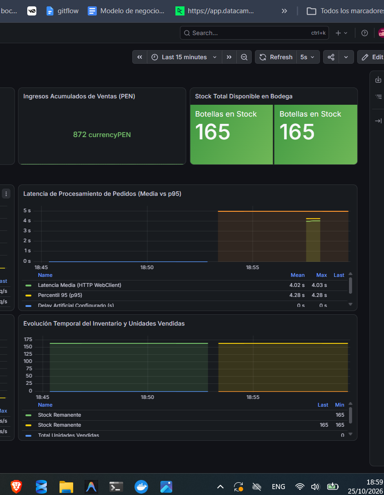 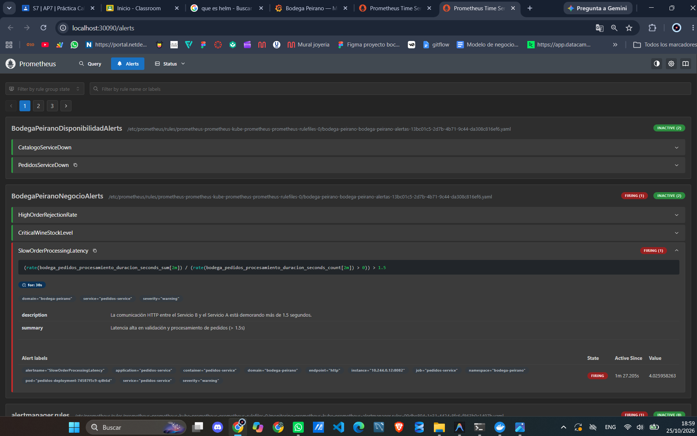]  |
> +-----------------------------------------------------------------------------------+
> ```
>  La captura demuestra que el delay inyectado en el Servicio A (5 segundos) supera el umbral de timeout del cliente reactivo en el Servicio B (4 segundos). El Timer de Micrometer registra el retraso antes del fallo, elevando el p95 y disparando la regla de alerta de latencia.

---

* **Comando de Resolución:**
  ```bash
  kubectl set env deployment/catalogo-deployment -n bodega-peirano ARTIFICIAL_DELAY_SECONDS="0"
  ```
  *(O seleccionar la opción 7 en el script interactivo)*.
* **Lección Técnica en tus Palabras:**
  En arquitecturas de microservicios, la latencia es un problema contagioso: **se propaga en cascada** aguas arriba. Sin observabilidad con percentiles (p95) y métricas de Gauge en tiempo real, el equipo de soporte culparía erróneamente al microservicio de Pedidos cuando el verdadero causante de la degradación es el Catálogo.

---

### 🟠 Casuística 3 — Regla de Negocio Propia (Desabastecimiento Crítico de Stock y Ráfaga de Rechazo de Pedidos)

* **Contexto Narrativo:** Se lanza una venta relámpago de vinos Gran Reserva. Varios restaurantes solicitan simultáneamente 500 botellas del vino `VINO-005` (cuando solo quedan 20 en bodega) y consultan códigos de botellas inexistentes. El motor de validación de negocio en el Servicio B rechaza sistemáticamente las compras.
* **Síntoma:** Los clientes ven que sus órdenes son rechazadas con error HTTP 400 y mensaje *"Stock insuficiente en bodega"*. La bodega sufre una fuga masiva de ingresos potenciales.
* **Comando de Activación:**
  Ejecutar la opción `2` en `./load-testing/stress.sh` o `stress.ps1` (envía 30 pedidos concurrentes pidiendo 500 botellas y vinos inexistentes).

---

> #### 📸 [EVIDENCIA 3A: CAPTURA DE PANTALLA REQUERIDA]
> **Qué capturar:** Dashboard de Grafana mostrando los paneles de negocio.  
> **Elementos visuales a resaltar:**
> 1. En Grafana: El panel Gauge *"Tasa Actual de Rechazo de Pedidos (%)"* subiendo a zona roja (> 40%).
> 2. El panel *"Flujo de Pedidos por Segundo"*, donde la serie temporal roja (pedidos rechazados) supera a la verde (aprobados).
> 3. En Prometheus: La alerta de negocio **`HighOrderRejectionRate`** en estado **FIRING**.
> 
> ```
> +-----------------------------------------------------------------------------------+
> | 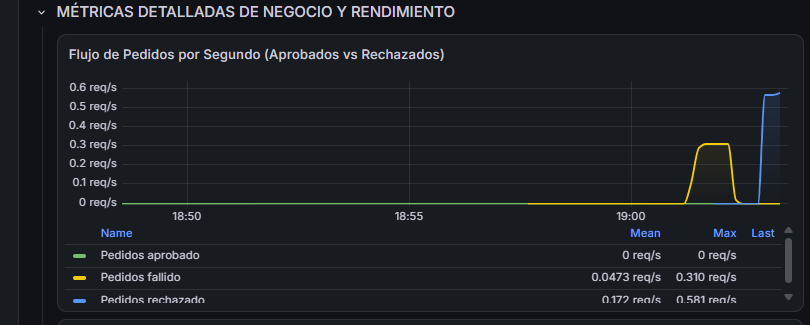 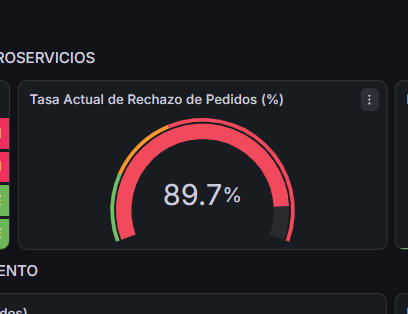  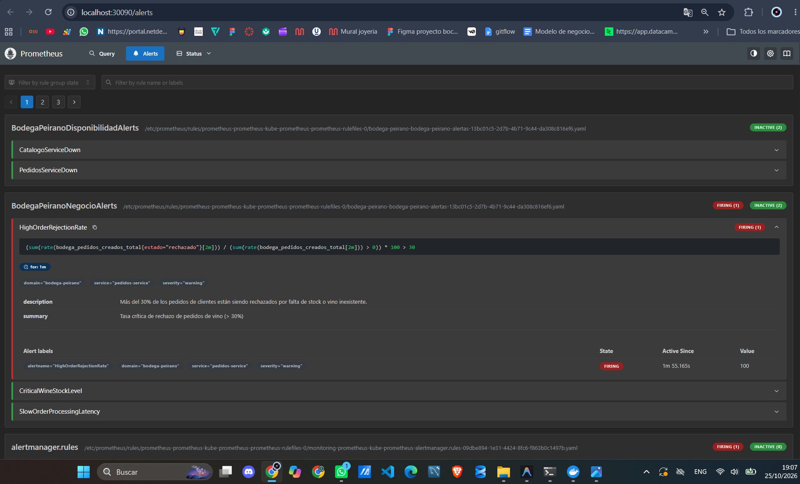+-----------------------------------------------------------------------------------+
> ```
>  Se evidencia que las métricas de negocio instrumentadas con Micrometer (`bodega_pedidos_tasa_rechazo` y `bodega_pedidos_creados_total{estado="rechazado"}`) permiten alertar anomalías funcionales del dominio antes de que los clientes reporten reclamos administrativos.

---

* **Comando de Resolución:**
  Reabastecer el inventario en el microservicio de Catálogo:
  ```bash
  curl -X PUT "http://<MINIKUBE_IP>:30081/api/vinos/VINO-005/restaurar-stock?cantidad=200"
  ```
* **Lección Técnica :**
  El monitoreo no debe limitarse a métricas técnicas de infraestructura (uso de CPU y memoria). Las **métricas de negocio (Business Observability)** son las que realmente reflejan si la plataforma cumple su objetivo comercial y permiten vincular la telemetría técnica con las metas de la empresa.

---

## 📷 Parte D — Evidencias del Sistema

A continuación se detallan las 4 evidencias globales que deben ser capturadas en el sistema en funcionamiento:

---

### Evidencia 1: Captura de `/targets` en Prometheus con ambos servicios en estado UP

> #### 📸 [EVIDENCIA 4.1: TARGETS DE PROMETHEUS EN UP]

> ```
> +-----------------------------------------------------------------------------------+
> | 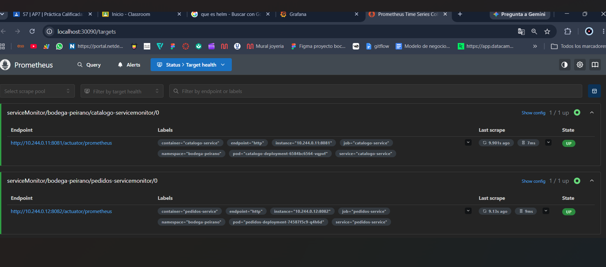 |
> +-----------------------------------------------------------------------------------+
> ```
> Demuestra que el Prometheus Operator descubrió correctamente ambos ServiceMonitors en el namespace `bodega-peirano` gracias a la directiva `serviceMonitorSelectorNilUsesHelmValues: false` y que los microservicios exponen sus métricas en formato scrape estándar.

---

### Evidencia 2: Captura del Dashboard de Grafana con los 8 paneles funcionando

> ```
> +-----------------------------------------------------------------------------------+
> 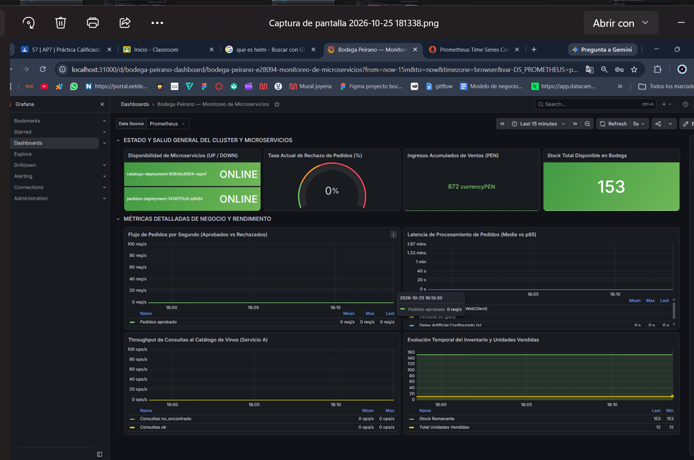     |
> +-----------------------------------------------------------------------------------+
> ```
> Certifica la correcta integración entre Prometheus como DataSource y Grafana, mostrando métricas reales generadas por el flujo de microservicios.

---

### Evidencia 3: Captura de `kubectl get pods` mostrando todos los pods en Running

> #### 📸 [EVIDENCIA 4.3: ESTADO RUNNING EN KUBERNETES]
> **Instrucción para la captura:**  
>+-----------------------------------------------------------------------------------+
> | [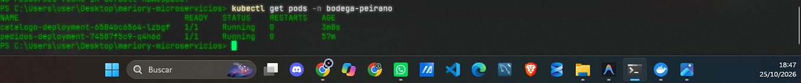]  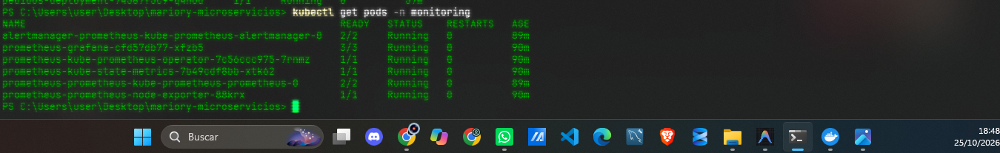 |
> +-----------------------------------------------------------------------------------+
> ```
> Demuestra que los contenedores pasaron satisfactoriamente sus sondas de `readinessProbe` y `livenessProbe`, que no presentan problemas de memoria ni de descarga de imágenes (`imagePullPolicy: IfNotPresent`).

---

### Evidencia 4: Captura de al menos una alerta en estado FIRING durante alguna casuística

> #### 📸 [EVIDENCIA 4.4: ALERTA EN ESTADO FIRING EN PROMETHEUS]

> 
> ```
> +-----------------------------------------------------------------------------------+
> | [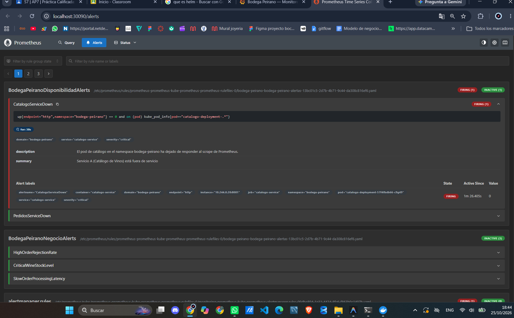]  |
> +-----------------------------------------------------------------------------------+
> ```
> Demuestra que las reglas declaradas en el manifiesto `k8s/prometheus-rules.yaml` son evaluadas periódicamente por Prometheus Operator y alertan oportunamente ante situaciones anómalas tanto de infraestructura como de lógica de negocio.

---

## 🏁 Conclusión General

La arquitectura implementada para **Bodega Peirano** demuestra cómo los estándares modernos de observabilidad en la nube (Cloud Native Observability) mediante **Micrometer**, **Prometheus Operator** y **Grafana** sobre **Kubernetes** permiten:
1. Detectar fallos de infraestructura (`CrashLoopBackOff`, fallos de probes) en tiempo real.
2. Identificar problemas de propagación de latencia distribuida y timeouts entre microservicios interdependientes.
3. Proteger las operaciones comerciales mediante métricas de negocio personalizadas.
